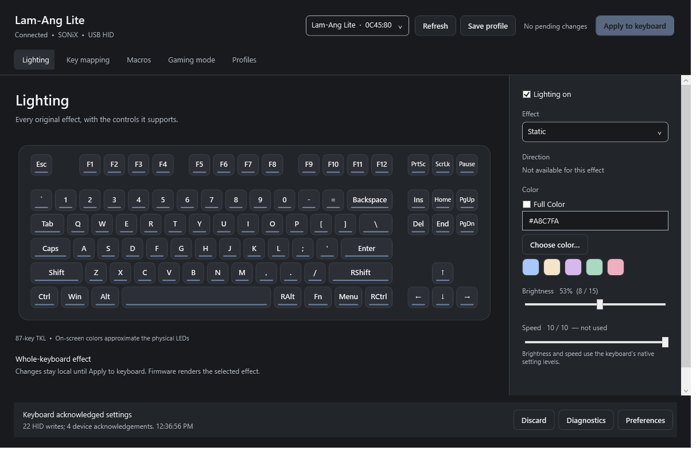

# Lam-Ang Studio

An unofficial, native Windows configuration app for the **RAKK Lam-Ang Lite**
keyboard with USB identity **`0C45:8006`**. Apply sends real HID configuration
reports directly to the keyboard; this is the executable application, not the
earlier browser mockup.

## Download and use

1. Download **`LamAngStudio.exe`** from [Releases](https://github.com/Ven-Ichi/lam-ang-studio/releases).
   This repository is private, so GitHub authentication and repository access are required.
2. Connect the keyboard by USB and close the original FineTuner while configuring.
3. Open the executable and confirm **Connected**.
4. Change settings, then click **Apply to keyboard** or press **Ctrl+Enter**.

**Save profile / Ctrl+S saves locally. It does not change the keyboard.**
Key assignments require **Stage assignment**, then Apply. Loading a complete
profile stages lighting, mappings, macros and gaming settings together.

The release is a standalone Windows x64 executable. It uses .NET Framework 4.8
and Windows' existing HID stack. No browser, web server, Python, Frida, original
FineTuner executable or adjacent DLLs are required at runtime.



## Features

| Area | Implemented |
| --- | --- |
| Lighting | All 20 original entries, on/off, single/Full Color, applicable speed and brightness |
| Direction | Scrolling: Up/Down; Rolling, Flowing, Tilt: Left/Right |
| Custom RGB | UserDefine per-key painting; All, Arrows, Numbers, Invert and Clear selection |
| Key mapping | Default/disabled, keyboard + modifiers, three-key chords, macros, mouse, multimedia, Windows shortcuts |
| Extended actions | Program, website, text and local-profile actions while the app is running |
| Macros | Keyboard/mouse recording, event/delay editing, reorder/delete, fixed/recorded delays, repeat/toggle configuration |
| Gaming | Windows-key, Alt+Tab and Alt+F4 locks |
| Profiles | Local storage, import/export, draft recovery, retained removed profiles and diagnostics |

[Feature details and effect matrix →](docs/FEATURES.md)

## Verification and current limits

As of **2026-10-17**:

- **63 offline protocol/profile checks passed.** They compare serializers against
  independent, artificial, write-blocked FineTuner captures and exercise validation/state handling.
- **36 native UI checks passed** on the development machine, including real Apply
  and brightness restoration on the connected keyboard.
- Static, Breath and retained Scrolling lighting transactions were accepted by
  the device. Ordinary successful transfers reported **22 writes / 4 matching ACKs**.
- The standalone packaged executable was also exercised, rather than only a test harness.

An ACK proves acceptance of a transaction, not the exact physical appearance of
every effect. Every macro/host-action playback path and power-cycle retention
have not all been physically exercised. Complete device-settings readback is
not implemented: a local profile is **not a fresh hardware backup**.

The UI is English; the original Chinese translations are not ported. Text-color
preferences are session-local. QMK/VIA, firmware flashing, adjustable polling,
arbitrary RGB streaming and Pro/Pro Max hardware features are outside the
implemented stock protocol.

[Hardware scope](docs/HARDWARE-SUPPORT.md) · [Testing and evidence levels](docs/TESTING.md)

## Build from a fresh clone

On Windows x64 with .NET Framework 4.8, PowerShell, Git and an installed,
authenticated GitHub CLI (`gh`) for this private-clone example:

```powershell
gh repo clone Ven-Ichi/lam-ang-studio
Set-Location lam-ang-studio
.\build.ps1
.\dist\LamAngStudio.exe
```

The build uses the framework's installed `csc.exe`, runs the offline checks and
embeds its theme/key-index resources. It does not require the .NET SDK, Visual
Studio, NuGet, Python, vendor binaries or local capture logs.

```powershell
.\build.ps1 -TestsOnly      # Offline checks and discovery helper build
.\build.ps1                # Offline checks + native app
.\build.ps1 -NativeChecks  # Requires a keyboard; sends real lighting settings
```

The **Windows build** GitHub Actions workflow runs the hardware-free build and
uploads an executable artifact. Native hardware checks are intentionally manual.

## Documentation

- [User guide](docs/USER-GUIDE.md): controls, workflows and shortcuts.
- [Features](docs/FEATURES.md): complete lighting/assignment/macro surface.
- [Building](docs/BUILDING.md): prerequisites, outputs, CI and release checksums.
- [Testing](docs/TESTING.md): offline versus device-writing checks and fixtures.
- [Architecture](docs/ARCHITECTURE.md): UI, worker process, state and host actions.
- [Protocol](docs/PROTOCOL.md): report framing, transactions, data offsets and ACKs.
- [Profile format](docs/DATA-FORMAT.md): schema, validation, storage and recovery.
- [Hardware support](docs/HARDWARE-SUPPORT.md): exact target and revision boundaries.
- [Troubleshooting](docs/TROUBLESHOOTING.md): discovery, Apply, recording and profiles.
- [Research sources](docs/RESEARCH.md): manufacturer/upstream references and provenance.
- [Contributing](CONTRIBUTING.md) · [Changelog](CHANGELOG.md)

## Source layout

```text
src/                  Native app, serializers, HID worker and embedded resources
tests/                Offline checks, discovery helper and opt-in native UI checks
tests/fixtures/       Portable artificial protocol payloads and provenance
scripts/              Optional fixture exporter and documentation checks
docs/                 Guides, protocol documentation and native UI screenshots
.github/workflows/    Hardware-free Windows build
```

Original installers/software, machine-specific captures, local profiles, logs,
browser sessions and generated executables are excluded from Git history.
Release binaries and CI artifacts are provided separately.

This is a private project; no open-source license has been selected.
