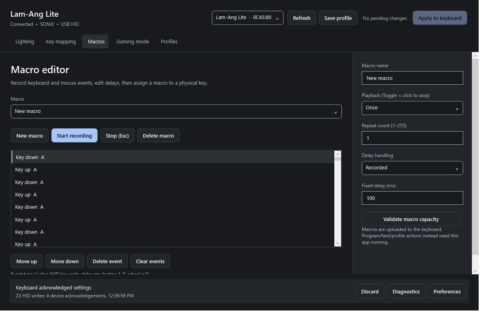

# User guide

[Documentation index](../README.md#documentation)

## The two kinds of save

- **Save profile / Ctrl+S** writes a local JSON profile.
- **Apply to keyboard / Ctrl+Enter** sends pending sections to the selected device.

The app does not write device settings just because it opened, a color was
previewed or a profile was saved. Discovery obtains identity/capabilities, not a
complete copy of the keyboard's current configuration.

## Connect and select

Connect the Lam-Ang Lite by USB, close FineTuner while configuring, and open
the app. The header shows the matching device. **Refresh / F5** re-enumerates it;
automatic discovery also runs approximately every five seconds when not applying.
If several matching devices are present, select the intended one. Device
selection is disabled during Apply.

## Lighting

1. Select an effect from the complete original list.
2. Adjust the available controls. Modes retain their individual settings in the draft.
3. For a specific color, turn **Full Color** off and use a swatch, color picker
   or six-digit `#RRGGBB` value.
4. Set brightness and applicable speed. The UI shows native levels, not an
   unsupported promise of 101 independent hardware values.
5. Apply.

Scrolling has **Up/Down**. Rolling, Flowing and Tilt have **Left/Right**. Other
modes explain that direction is unavailable. Colourful/Spectrum use their own
colors; Static/UserDefine do not use speed. See [the effect matrix](FEATURES.md).

### Paint custom colors

Choose **UserDefine**. Select physical keys, or use All/Arrows/Numbers/Invert/Clear.
Choose **Paint color**, then **Paint selection**. **Turn selection off** paints
black. Apply the lighting section to send the map. The visual layout approximates
LED colors; it is not a live photograph or a device readback.

## Key mapping

Select a physical key and choose its assignment. Keyboard assignments can include
left/right modifiers; combinations contain up to three HID keys. Multimedia,
mouse and Windows shortcut actions have named choices. Accepted destinations not
printed on the physical keyboard remain selectable as explicit USB HID values.

**Stage assignment** validates and changes the local draft. **Restore key**
removes that key's override. Apply sends the full programmable key map, including
the other overrides in the profile; it does not send only the selected row.

Program, website, text and local-profile actions are dispatched by the resident
app from vendor HID events. Keep it running and reapply the map/profile after
restart. Missing programs/profiles are reported, rather than replaced by another
target. These actions are not a claim that the keyboard can launch Windows
programs without host software.

A configured **Switch local profile** key is an automation action: pressing it
retains the previous draft, loads the target local profile and **immediately
applies all four programmable sections**. This differs from clicking Load selected
or Import JSON, which only stages a draft until you explicitly Apply.

## Macros

1. Create a macro and give it a name.
2. Start recording keyboard/mouse input; **Esc** or **Stop** ends recording.
3. Review the timeline. Insert or edit key, delay, mouse and wheel events;
   reorder/delete as needed. Numeric key values use USB HID usages, not Windows VK codes.
4. Choose Once, Repeat (1–255) or Toggle/click-to-stop configuration, plus recorded
   or fixed delays.
5. Validate capacity, then bind the macro to a key in Key mapping and Apply.

Recording is global **only while enabled**; ordinary injected input is ignored.
The recorder reserves space for release events so stopping does not leave a
recorded key/mouse button held. The local editor allows up to 600 events per macro,
but the complete upload must also fit the recovered 3200-byte transfer format.
An oversized local macro remains editable; reduce it before uploading.

## Gaming mode

Enable Gaming mode and choose Windows-key, Alt+Tab and/or Alt+F4 locks, then Apply.
Disable Gaming mode and Apply to release these locks. These use the keyboard's
configuration protocol; the app does not implement them by suppressing Windows shortcuts.

## Profiles and recovery

New, Duplicate, Load selected, Remove, Import JSON and Export JSON manage local
data. **Apply complete profile** explicitly stages/sends lighting, mappings,
macros and gaming locks. A loaded JSON profile is not automatically a hardware backup.

Discard returns to the saved local profile without sending commands. If that
profile differs from this session's acknowledged bytes, the corresponding
sections remain pending. Removed profiles are retained in a recovery folder;
keyboard-triggered profile switches retain the prior draft.

[Storage and recovery locations](DATA-FORMAT.md#storage)

On startup the app attempts to load `Draft.json`. For manual recovery, copy a
retained `.backup`, removed-profile or recovered-draft file to a `.json` filename
if necessary, then **Import JSON → Save profile**. Inspect it before explicitly
applying it if you want to change the device. `Last acknowledged.json` can include
other draft sections that were not sent; use the matching log to determine the
operation's acknowledged scope.

## Diagnostics, preferences and shortcuts

Diagnostics shows identity, the last transaction path and actual response data.
Preferences includes system appearance refresh, a contrast-checked session text
color, the profile folder and **Stage factory-style defaults**. Staging defaults
does not flash firmware or issue an unknown hardware reset command; Apply is
still required.

| Shortcut | Action |
| --- | --- |
| Ctrl+Enter | Apply pending sections |
| Ctrl+S | Save local profile |
| Ctrl+O | Import a JSON profile |
| F5 | Refresh devices |
| Esc while recording | Stop recording |

The app follows Windows appearance/high-contrast settings. At narrow widths,
the inspector moves below the keyboard and the editor scrolls while the header
and feedback remain available.
